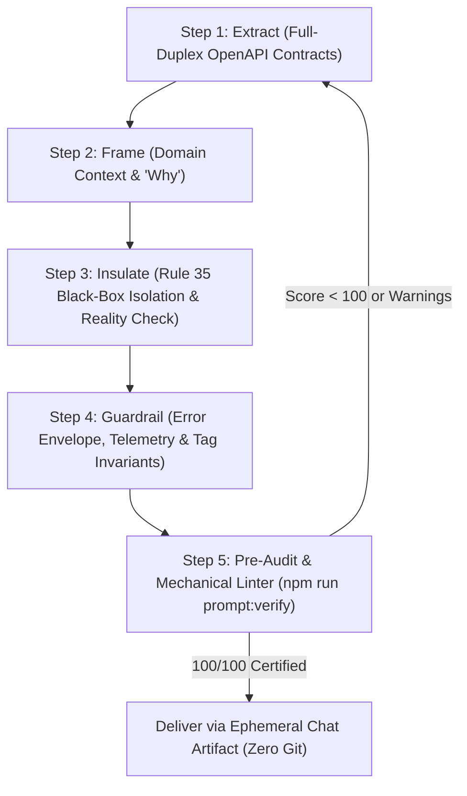

# 📜 Prompt Engineer & AI Delegation Directives (Black-Box Specifications)

When authoring prompts, migration briefs, or cross-repo instructions for other AI agents:

### 0. The Ephemeral Delegation Lifecycle (Zero Prompts in Git)
Prompts and delegation briefs are temporary single-use handoffs between AI agents. They are **ephemeral** and MUST NEVER be committed to Git:
- **Where Prompts Live**: Stored strictly in chat session artifacts or gitignored scratchpads (`scratch/prompt.md`).
- **How Prompts Are Verified**: Verified on-the-fly in-memory or via `npm run prompt:verify -- --text "<prompt>"` before delivery.
- **Git Hygiene**: `docs/ai_prompts/` and `scratch/` are strictly gitignored. Staging prompt files into Git is strictly prohibited.

---

### 1. The 5-Step Golden Authoring SOP (100/100 Standards)



1. **Step 1: Extract (Full-Duplex Contract Extraction — Zero Half-Duplex Hand-Typing)**:
   - Programmatically extract routes and schemas directly from `openapi.json`:
     ```bash
     npm run prompt:extract -- <METHOD> <PATH>
     ```
   - **Full-Duplex Mandate**: Every documented endpoint MUST include:
     - Full Request Body schema (including all required fields, e.g. `data.id`, `data.name`).
     - Standard 200/201 Success Response Wire Envelope (`{ success: true, count, item, items, ... }`).
     - Canonical HTTP Error Status Codes (`400`, `401`, `403`, `404`, `426`, `500`).
   - Never hand-type parameter tables from memory or truncate required sub-properties.

2. **Step 2: Frame (The Context & The "Why")**:
   - Codify systemic paradigms, domain rationale, business models, and topology invariants.
   - For BUMPS Interventions: synthesize Ackoff's 6 Problem Approaches (`absolve`, `dissolve`, `resolve`, `solve`, `evolve`, `revolve`), anti-solutionism, and sovereign dual-edge topology (`problem-intervention` and `intervention-solution`).

3. **Step 3: Insulate (Rule 35 Black-Box Isolation & Target Reality Check)**:
   - **Target Repository Reality Check**: Before authoring, inspect the target repository's `package.json` (runtime type `.mjs` vs `.ts`, dependencies, scripts).
   - **Archetype Classification**:
     - *Service/App* (HTTP server, client SPA/PWA): Cites HTTP endpoints, client interceptors, cloud telemetry.
     - *Tooling/Content/CLI* (offline compiler, static markdown catalog, CLI scripts): Prescribe CLI failure signals (`console.error` to stderr + `process.exit(1)`). If citing ecosystem OpenAPI endpoints, explicitly clarify that they describe the *downstream consumer / ingestion contract*.
     - *Graphics/Engine* (WebGL, Three.js, Canvas): Cites graphics context loss, rendering loops, mesh/shader memory.
   - **Absolute Black-Box Boundary**: The receiving agent is autonomous. Do NOT prescribe internal directory paths (`src/schemas/`, `src/flows/`, `app/features/`, `src/views/`), internal filenames, or internal class implementations (e.g. zero `ClassName.methodName` leaks).
   - **Quality Gate Realism**: In Section 5 (DoD), map verification gates to the target repository's *actual* `package.json` scripts (e.g. `npm run validate`, `npm run bundle`, `npm test` vs `npm run build`), or use abstract quality gates. Never prescribe non-existent scripts.
   - Zero local user paths (`/Users/...`).

4. **Step 4: Guardrail (Error Envelope, Telemetry, Tag Invariants & Cognitive Bounds)**:
   - **Rule 29 Telemetry & Signals**: 
     - For services/apps: Mandate structured `reportCrash(error, '<Scope>.<action>', { code, severity: 'error', details })`.
     - For CLI/compilers: Mandate structured stderr diagnostic log and immediate `process.exit(1)`.
   - **Tag Ontology Invariants (Rule 24 & Rule 30)**:
     - In arrays and data documents: Clean string tokens without `#` (e.g. `["methodology", "framework"]`).
     - In prose and `description:`: Prefixed `#hashtags` (e.g. `#methodology #framework`) for human readability and UX tag derivation.
     - Mandate rejection of deprecated legacy attributes (`id`, `title`, `author`, `category`, `subCategory`, `isDraft`).
   - **Standard Error Wire Envelope**: Include canonical `ErrorResponse` (`success: false`, `code`, `message`, `correlationId`).
   - **Cognitive Modularity Bounds (Rule 2 & Rule 5)**: Bounded deliverables only. Mandate implementation in modular increments of $\le 3$ source files per verification cycle.

5. **Step 5: The Producer Gate (Authoring-Time Verification & Scratchpad Lifecycle)**:
   - **Write to Scratchpad First**: Authoring agents MUST write prompt drafts to `scratch/temp_prompt.md` (which is strictly gitignored). Never output an unverified prompt directly into chat or markdown artifacts.
   - **Run Mechanical Verification**: Execute `npm run prompt:verify scratch/temp_prompt.md`.
     Audit the output to guarantee: 0 parameter discrepancies against OpenAPI ground truth, 0 domain mismatches, 0 banned tokens (`pov`, `_to_`, `contentNode`), 0 internal path leaks, complete Quad-Layer DoD checklists, and achieving a **Total Prompt QA Score of 100 / 100** (✅ PROMPT ACCEPTED).
   - **Delete Scratchpad**: After obtaining 100/100 verification, delete the temporary scratchpad: `rm scratch/temp_prompt.md`.
   - **Mandatory Terminal Proof in Final Delivery**: Agents are strictly forbidden from outputting prompts in chat or artifacts without embedding the literal terminal verification stdout showing the 100/100 score. Outputting prompts without empirical verification proof is a severe governance violation.

---

### 2. Pre-Flight Authoring Checklist

- [ ] **Step 1 (Extract)**: Did I run `npm run prompt:extract -- <METHOD> <PATH>` instead of hand-typing contracts from memory?
- [ ] **Step 1 (Extract)**: Are correlation IDs placed on the `X-Correlation-ID` HTTP header for 200 responses (never inside the 200 body)?
- [ ] **Step 1 (Extract)**: Do error codes match the canonical `ErrorResponse.error.code` enum from `openapi.json` (zero synthetic codes)?
- [ ] **Step 1 (Extract)**: Do entity IDs obey schema constraints (e.g. `minLength: 20` for primary entities)?
- [ ] **Step 2 (Frame)**: Does the context accurately reflect domain concepts and anti-solutionist paradigms?
- [ ] **Step 3 (Reality Check)**: Did I inspect target `package.json` scripts and classify repository archetype (Service/App vs Tooling/CLI vs Graphics)?
- [ ] **Step 3 (Insulate)**: Are internal file paths and class/method names strictly omitted (Rule 35 black box)?
- [ ] **Step 3 (Insulate)**: Are prescribed DoD commands verified to exist in the target `package.json`?
- [ ] **Step 3 (Insulate)**: Are machine-specific paths (`/Users/...`) completely absent?
- [ ] **Step 4 (Guardrail)**: Are tags in arrays clean tokens (`["tag"]`) and in descriptions `#hashtags` (`#tag`)?
- [ ] **Step 4 (Guardrail)**: Is telemetry appropriate for archetype (Cloud `reportCrash` for services vs stderr + `process.exit(1)` for CLI)?
- [ ] **Step 4 (Guardrail)**: Is cognitive modularity explicitly bounded to $\le 3$ files per verification cycle (Rule 5)?
- [ ] **Step 5 (Audit)**: Did `npm run prompt:verify` pass with 0 errors and 0 warnings?
- [ ] **Step 5 (Audit)**: Does the draft score 100/100 on `roles/prompt_qa_reviewer.md`?
